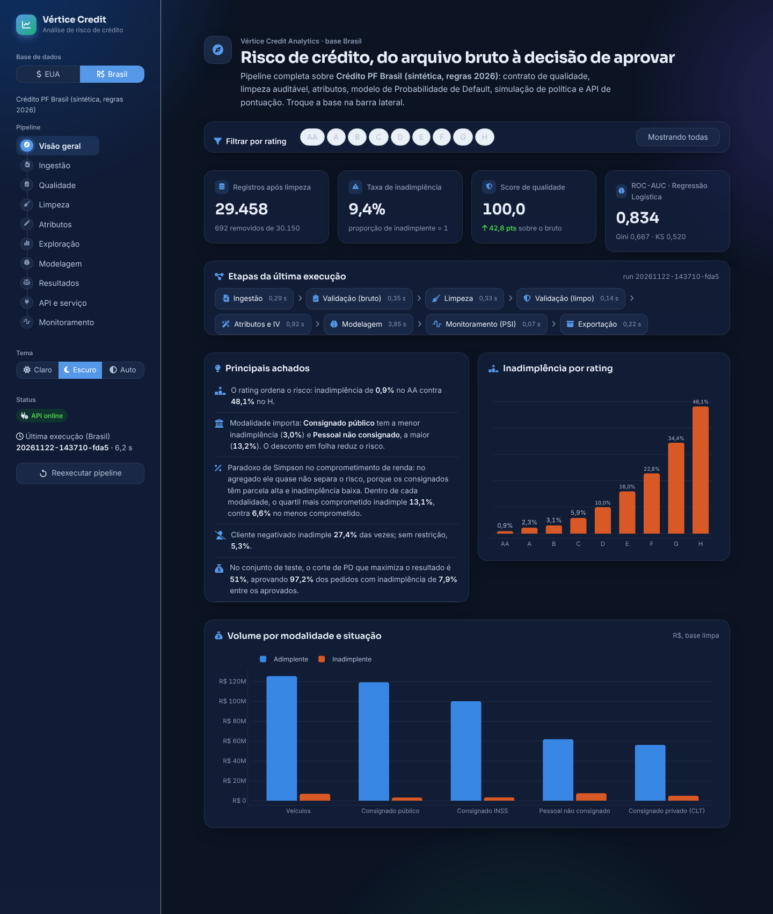
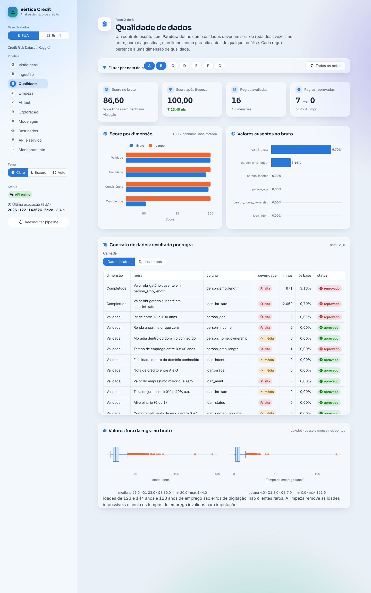

# Vértice Credit Analytics

Pipeline completa de análise de risco de crédito em Python, aplicada a **duas bases**: uma americana (Kaggle) e uma brasileira, construída com as regras de crédito do Brasil em 2026. O projeto vai do arquivo bruto até a decisão de aprovar ou recusar: contrato de qualidade, limpeza auditável, engenharia de atributos, modelo de Probabilidade de Default (PD), simulação de política de crédito, API REST e dashboard interativo.


| Camada | Ferramentas |
|---|---|
| Dados e persistência | pandas, NumPy, SQLite (SQLAlchemy 2, um banco por base), Parquet (PyArrow) |
| Qualidade de dados | Pandera (contrato de dados por base, com dimensões de qualidade) |
| Modelagem | scikit-learn (`Pipeline`, `ColumnTransformer`, validação cruzada, importância por permutação), joblib |
| Serviço | FastAPI, Pydantic v2 (com validação das regras brasileiras), Uvicorn |
| Dashboard | Streamlit, Plotly, Font Awesome 6 (servido localmente), glassmorphism, temas claro, escuro e automático |
| Engenharia | pytest, Ruff, Makefile, Docker / Docker Compose |

## Sobre os dados: de onde vem cada base

### Base EUA: Credit Risk Dataset (Kaggle)

- **Origem:** publicada por Lao Tse no Kaggle ([link](https://www.kaggle.com/datasets/laotse/credit-risk-dataset)), licença CC0.
- **O que ela é de verdade:** a descrição oficial diz apenas que as colunas **simulam dados de bureau de crédito**. Ela não informa país, período, instituição nem o método usado para gerar os dados. Os valores estão em dólar e as categorias (moradia `RENT/OWN/MORTGAGE`, notas `A–G`) seguem o mercado americano.
- **O que isso significa para a análise:** os registros não são pessoas reais e os números não descrevem nenhum mercado específico. A base serve para praticar o método (limpeza, modelagem, política), não para tirar conclusões sobre o crédito nos EUA.
- **Por que ela é útil mesmo assim:** tem problemas de qualidade reais o bastante para justificar a limpeza: 165 duplicatas, 3.116 taxas de juros ausentes, 895 tempos de emprego ausentes, idades de 123 e 144 anos e 123 anos de emprego para alguém de 22.

### Base Brasil: crédito pessoa física com regras de 2026 (sintética)

- **Por que sintética:** não existe base pública brasileira contrato a contrato com o desfecho de pagamento. Os dados individuais do Sistema de Informações de Crédito (SCR) do Banco Central são protegidos por sigilo bancário, e o SCR.data publica apenas agregados. Por isso a base é **gerada pelo próprio projeto**, com semente fixa (`src/vertice/datasets/br_generator.py`), o que a torna 100% reprodutível.
- **O que ela tem de real:** as regras e a calibração. São 30 mil propostas distribuídas pelas 27 UFs em proporção à população, com cinco ocupações e cinco modalidades. A inadimplência de cada modalidade foi calibrada para ficar perto das taxas divulgadas pelo Banco Central em 2026.
- **Sujeira típica de dados brasileiros, injetada de propósito:** renda em texto (`R$ 3.450,00`), datas em dois formatos (`dd/mm/aaaa` e ISO) e datas impossíveis (`31/02/2026`), UF minúscula ou por extenso, `S/N` misturado com `Sim/Não`, CSV com `;` e BOM para o Excel em português, duplicatas e contratos que violam a regulação.

Regras usadas na validação, na limpeza, na API e no gerador. Todas ficam em `src/vertice/datasets/br_rules.py`:

| Regra | Valor usado | Fonte |
|---|---|---|
| Salário mínimo 2026 (piso de renda formal) | R$ 1.621,00 | Decreto nº 12.797/2025 |
| Teto de juros do consignado INSS | 1,85% ao mês | CNPS (vigente em out/2026) |
| Margem consignável INSS e servidor | 45% da renda | A MP 1.355/2026 chegou a reduzir para 40%, mas perdeu a validade |
| Margem do consignado CLT (Crédito do Trabalhador) | 35% do salário | Lei do Crédito do Trabalhador |
| Prazo máximo do consignado INSS | 108 meses | Regras de 2026 |
| Escala de risco | AA a H | Res. CMN 2.682/1999, revogada em 1º/1/2025 pela Res. CMN 4.966/2021, mas ainda usada no SCR |
| Inadimplência | atraso acima de 90 dias | Ativo problemático (estágio 3) na Res. CMN 4.966/2021 |
| Parcela | Tabela Price | Padrão do crédito pessoal no Brasil |

Inadimplência-alvo da calibração, por modalidade, próxima dos dados do BC em 2026: consignado INSS cerca de 4%, consignado público cerca de 3%, consignado privado (CLT) cerca de 10%, pessoal não consignado cerca de 13% e veículos cerca de 7%. As taxas médias seguem a mesma lógica: consignado INSS perto de 1,7% a.m., CLT em torno de 3,4% a.m. e pessoal não consignado em torno de 6% a.m.

> Os números são uma aproximação didática das estatísticas públicas, não uma réplica de nenhuma carteira real. Antes de usar como referência, confira os valores atualizados nas fontes ao fim deste README.

Um achado que só a base brasileira mostra: o **paradoxo de Simpson** no comprometimento de renda. No agregado, ele quase não separa bons e maus pagadores, porque os consignados têm parcela alta e inadimplência baixa. Dentro de cada modalidade, quem compromete mais da renda inadimple bem mais.

## Fases da pipeline

| # | Fase | O que acontece | Saída no SQLite |
|---|---|---|---|
| 1 | Ingestão | Lê o arquivo sem alterar conteúdo, calcula SHA-256 | `raw_loans` |
| 2 | Validação (bruto) | Contrato Pandera por dimensão: completude, validade, unicidade, consistência (+ formato e conformidade regulatória na base Brasil) | `quality_checks`, `quality_dimensions` |
| 3 | Limpeza | Regras em ordem, cada uma registrada com linhas afetadas | `cleaning_log` |
| 4 | Validação (limpo) | Mesmo contrato, agora como garantia (score 100) | `quality_checks` |
| 5 | Atributos e IV | Atributos de negócio + WoE/IV por variável | `clean_loans`, `feature_woe`, `feature_iv` |
| 6 | Modelagem | Baseline × Regressão Logística × Gradient Boosting, CV 5 folds, registro versionado | `model_metrics`, `test_predictions`, `feature_importance`, `model_registry` |
| 7 | Monitoramento | PSI (estabilidade da população) treino × teste | `feature_psi` |
| 8 | Exportação | CSV + Parquet da base limpa e relatório JSON da execução | `data/processed/<base>/`, `reports/<base>/` |

Cada base tem o próprio banco (`data/vertice_us.db`, `data/vertice_br.db`) e os próprios modelos (`models/us/`, `models/br/`).

## Dashboard

- **Seletor de base** na barra lateral (EUA ou Brasil). Todas as páginas, gráficos e a API passam a usar a base escolhida.
- **Filtro por nota/rating no topo de todas as páginas.** Ele vale para todos os gráficos e indicadores: o contrato de qualidade, o log de limpeza, o IV, as métricas do modelo, a política e o PSI são recalculados para o recorte. Nenhuma nota marcada significa todas.
- **Camada de carregamento:** quando o processamento passa de 350 ms, a tela recebe um véu de vidro com o aviso "Carregando".
- **Temas:** claro, escuro ou automático (segue o sistema operacional).
- **Simulador de proposta:** pontua pela API, com fallback local. Na base Brasil, a proposta passa pelas regras regulatórias antes de ser pontuada.

## Como executar

Requer Python 3.11 ou superior.

**Windows (PowerShell):**

```powershell
cd vertice-credit-analytics           # a pasta que contém pyproject.toml
pip install -r requirements-dev.txt
pip install --no-deps -e .

python -m vertice.pipeline.runner     # as duas bases (opcional: o dashboard roda sozinho)
python -m uvicorn vertice.api.main:app --port 8000   # terminal 1
python -m streamlit run app/app.py                    # terminal 2
```

Se o comando `python` não funcionar, chame o executável pelo caminho completo. O próprio pip mostra esse caminho nos avisos.

**Linux/macOS:**

```bash
python -m venv .venv && source .venv/bin/activate
pip install -r requirements-dev.txt && pip install --no-deps -e .
make pipeline   # ou: python -m vertice.pipeline.runner --dataset br
make api        # terminal 1
make app        # terminal 2
```

Com Docker: `docker compose up --build`.

A base brasileira pode ser regerada com `python -m vertice.datasets.br_generator`; a semente fixa garante o mesmo arquivo.

## API

Documentação interativa em `http://127.0.0.1:8000/docs`. As rotas de leitura aceitam `?dataset=us` (padrão) ou `?dataset=br`.

| Rota | Uso |
|---|---|
| `GET /health` | Estado da API e de cada base |
| `POST /pipeline/run?dataset=br` | Executa a pipeline de uma base |
| `GET /overview?dataset=br&grades=AA&grades=A` | Indicadores, com filtro por notas |
| `GET /data/loans`, `GET /data/segments/{dimensão}` | Consultas na base limpa |
| `GET /quality/checks`, `GET /quality/cleaning-log` | Contrato de dados e log de limpeza |
| `GET /models`, `GET /models/champion`, `GET /models/policy` | Métricas, campeão e curva de política |
| `POST /predict` | Pontua um pedido da base EUA |
| `POST /br/predict` | Pontua uma proposta brasileira. Responde **422** com o motivo se violar teto do INSS, margem consignável, elegibilidade ou prazo |

## Testes

```bash
pytest
```

São 18 testes de pipeline e API para as duas bases, rodando em diretórios temporários (os bancos do projeto não são tocados). Eles cobrem o contrato reprovando o bruto e aprovando 100% do limpo, a conversão de moeda e datas brasileiras, a Tabela Price, as regras regulatórias na limpeza e na API, o filtro por notas, o PSI e a ordenação de risco do modelo.

## Estrutura

```text
vertice-credit-analytics/
├── app/                        # dashboard Streamlit
│   ├── app.py                  # entrada: seletor de base, trilho da pipeline, tema
│   ├── ui.py                   # tema, glassmorphism, filtro por nota, camada de carregamento
│   ├── charts.py               # tema Plotly e fábricas de gráficos
│   ├── data.py                 # cache por base/execução/filtro e cliente da API
│   ├── views/                  # uma página por fase
│   └── static/                 # Font Awesome e fontes (Sora, Inter), offline
├── src/vertice/
│   ├── config.py, context.py   # configuração global e base ativa (ContextVar)
│   ├── datasets/               # us.py, br.py, br_rules.py, br_generator.py: tudo que é específico de cada base
│   ├── pipeline/               # ingestion, validation, cleaning, features, modeling, monitoring, runner (genéricos)
│   ├── services.py             # consultas e inferência compartilhadas por API e dashboard
│   └── api/                    # FastAPI e contratos Pydantic
├── data/raw/                   # credit_risk_dataset.csv e credito_brasil_sintetico.csv
├── tests/
└── docs/screenshots/
```

Para adicionar uma terceira base, basta criar um módulo em `datasets/` que devolva um `DatasetSpec` e registrá-lo em `datasets/__init__.py`. A pipeline, a API e o dashboard não mudam.

## Decisões técnicas

- **Camada bruta imutável** com impressão SHA-256 registrada a cada execução.
- **Contrato em vez de checagens soltas:** as regras de qualidade de cada base vivem num esquema Pandera único, aplicado antes e depois da limpeza.
- **Sem vazamento de dados:** valores imputados na limpeza ganham flag e voltam a ser nulos na modelagem, onde a imputação é ajustada só no treino.
- **Ausência estrutural não é dado faltante:** aposentado não tem tempo de emprego, então o campo vira 0 com registro no log, em vez de ser imputado.
- **Contratos irregulares saem da base:** consignado acima do teto, fora da margem ou sem elegibilidade não deveria existir, então não entra no modelo.
- **PD calibrada:** sem `class_weight`; o desbalanceamento é tratado no ponto de corte, que é decisão de negócio.
- **Uma fonte de verdade:** API e dashboard usam a mesma camada de serviços e as mesmas regras.

## Telas

| Base Brasil, tema escuro | Qualidade filtrada por notas, tema claro |
|---|---|
|  |  |

## Fontes

- [Credit Risk Dataset — Kaggle](https://www.kaggle.com/datasets/laotse/credit-risk-dataset)
- [Decreto nº 12.797/2025 — salário mínimo de 2026](https://www.planalto.gov.br/ccivil_03/_ato2023-2026/2025/decreto/d12797.htm)
- [Resolução nº 2.682/1999 (revogada pela Res. CMN 4.966/2021)](https://normativos.bcb.gov.br/Lists/Normativos/Attachments/44961/Res_2682_v3_P.pdf)
- [SCR.data — metodologia (dados agregados do SCR)](https://www.bcb.gov.br/content/estabilidadefinanceira/scr/scr.data/scr_data_metodologia.pdf)
- [Teto do consignado INSS e margem de 45% (out/2026)](https://www.jornalopcao.com.br/ultimas-noticias/consignado-do-inss-volta-a-ter-margem-de-45-mas-cartoes-seguem-suspensos-867983/)
- [Inadimplência por modalidade em agosto de 2026](https://www.tribunapr.com.br/noticias/economia/inadimplencia-das-familias-atinge-recorde-de-8-em-agosto/amp/)
- [Margem de 35% e taxa do consignado CLT](https://diariodopara.com.br/seu-bolso/consignado-privado-encolhe-e-inadimplencia-cresce-veja-o-que-esta-por-tras/)
- [Estatísticas monetárias e de crédito — Banco Central](https://www.bcb.gov.br/estatisticas/estatisticasmonetariascredito)
